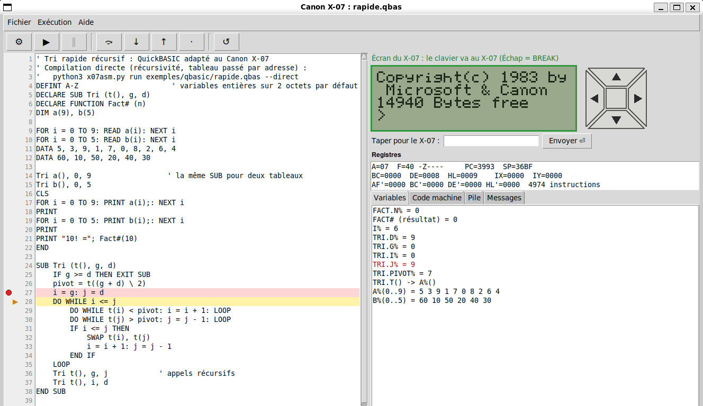

# Débogueur

Le débogueur exécute un programme machine **dans l'émulateur**, sur la vraie ROM du X-07. On peut le suivre instruction par instruction, l'arrêter où l'on veut, et regarder ou modifier les registres, la mémoire et les variables.

```sh
python3 x07asm.py debug exemples/bonjour.asm                 # programme assembleur
python3 x07asm.py debug exemples/premiers.bas                # BASIC, compilé au passage
python3 x07asm.py debug exemples/qbasic/tri.qbas             # QuickBASIC, traduit puis compilé
python3 x07asm.py debug prog.bin --org 3000                  # binaire seul (sans étiquettes)
python3 x07asm.py debug exemples/graphisme.bas --fenetre     # avec l'écran du X-07 en direct
```

Le programme est préparé comme sur la machine, par `CLEAR 50,&H…` puis `EXEC`. Le débogueur s'arrête sur la première instruction et attend une commande :

```
Débogueur X-07 : h pour l'aide, q pour quitter.
[départ]
A=00 F=44 -Z-P--  BC=F16B DE=0068 HL=001B  IX=0000 IY=0000 SP=1BCB PC=1C00
> 1C00  DEBUT          CALL  LCDCLS            ; CLS ($CE9E)
(x07) n
A=00 F=44 -Z-P--  BC=F16B DE=0068 HL=001B  IX=0000 IY=0000 SP=1BCB PC=1C03
> 1C03  DEBUT+3        LD    HL,MSG
```

Chaque arrêt affiche :
- les **registres**, et les indicateurs en clair (`S Z H P N C`, `-` quand l'indicateur est à 0) ;
- la **prochaine instruction**, avec son étiquette, les noms des routines et des variables de la ROM, et le commentaire du source.

## Éditeur-débogueur visuel

```sh
python3 x07asm.py ide exemples/qbasic/rapide.qbas
python3 x07asm.py ide exemples/table.bas --ram 16 --zoom 4
python3 x07asm.py ide                                  # puis « Nouveau » ou « Ouvrir… »
python3 x07asm.py ide exemples/qbasic/journal.qbas --memoire x07.mem   # fichiers gardés
```



La même mécanique que la commande `debug`, dans une fenêtre :

- **À gauche, le source**, modifiable : `.asm`, `.bas` (BASIC du X-07) ou `.qbas` (compilé directement).
  - Un **clic dans la marge** pose ou enlève un point d'arrêt (pastille rouge). Sur une ligne sans code (vide, commentaire, `DATA`), le point va sur la ligne suivante qui en contient.
  - Les points d'arrêt **suivent les modifications** : insérer des lignes au-dessus les déplace avec leur instruction.
  - La **ligne en cours** est surlignée en jaune, avec une flèche.
  - En BASIC du X-07 et en QuickBASIC, les **mots-clés** sont en bleu, les **fonctions** en violet, les **chaînes** en rouge, les **commentaires** en vert italique et les **numéros de ligne** en gris. En BASIC du X-07, les mots-clés sont reconnus comme le fait la ROM, même collés (`FORI=1TO9`). En assembleur, les instructions sont en bleu, les directives (`ORG`, `DB`, `EQU`…) en bleu-vert, les registres et conditions en orange, les étiquettes en brun gras, les chaînes et les commentaires comme en BASIC.
- **À droite, l'écran du X-07** en direct, avec son **pavé de flèches** : un clic sur une flèche ou sur le bouton du milieu agit comme la touche du X-07, tenue tant que le bouton de la souris est enfoncé (`STICK`, `STRIG(1)` ; voir [EMULATEUR.md](EMULATEUR.md)). Pour répondre au programme (`INPUT`, `INKEY$`), deux moyens :
  - **cliquer sur l'écran**, puis taper. Un **cadre vert** et la mention « le clavier va au X-07 » montrent qu'il reçoit le clavier ; Échap fait BREAK ;
  - **le champ « Taper pour le X-07 »**, sous l'écran : on y tape une valeur, puis Entrée (ou « Envoyer »). C'est la voie la plus sûre, quel que soit le focus. Le texte part tel qu'il est écrit, puis Entrée.

  Sur un clavier AZERTY, les chiffres du haut demandent Maj (ou le pavé numérique) : sans Maj, l'écran reçoit « è » au lieu de « 7 ». Le champ de saisie évite ce piège.

  Les touches tapées pendant que le programme est **arrêté** (au départ, ou sur un point d'arrêt) sont **gardées** : le programme les lira en repartant, et la barre d'état le signale.
- **Les registres**, avec les indicateurs en clair et le nombre d'instructions exécutées.
- **Des onglets :**
  - *Variables* : les variables par leur nom, et les tableaux avec leurs premières valeurs. Une valeur qui vient de changer apparaît **en rouge**. Pour un tableau reçu en paramètre, on voit lequel (`TRI.T() -> A%()`). Pour un programme assembleur, ce sont les étiquettes de données (octets et texte).
  - *Code machine* : le désassemblage autour du PC.
  - *Pile*.
  - *Messages* : avertissements de compilation, erreurs.

Les commandes sont dans la **barre de menus** (Fichier, Exécution, Aide). Celles du débogage ont aussi un **bouton à symbole**, avec une bulle d'aide au survol :

| Menu | Bouton | Touche | Rôle |
|---|---|---|---|
| Fichier › Nouveau | | | nouveau programme : BASIC du X-07 (`.bas`), QuickBASIC (`.qbas`) ou assembleur (`.asm`) ; on choisit le nom, et le programme part d'un petit modèle qui fonctionne |
| Fichier › Ouvrir… | | Ctrl+O | ouvrir un programme |
| Fichier › Enregistrer | | Ctrl+S | |
| Fichier › Enregistrer sous… | | Ctrl+Maj+S | enregistrer sous un autre nom, qui devient le fichier ouvert ; les points d'arrêt sont gardés. L'extension choisit le langage |
| Exécution › Compiler | ⚙ | | enregistre puis compile (aussi fait automatiquement avant de lancer un programme modifié) |
| Exécution › Continuer | ▶ | F5 | jusqu'au prochain point d'arrêt, ou la fin |
| Exécution › Pause | ‖ | F9 hors du source | interrompt le programme, même s'il attend une touche |
| Exécution › Ligne suivante | ⤼ | F10 | une **ligne du source**, sans entrer dans les procédures appelées |
| Exécution › Entrer dans la procédure | ↓ | F11 | une ligne du source, en entrant dans les `SUB`, `FUNCTION`, `GOSUB` |
| Exécution › Sortir de la procédure | ↑ | Maj+F11 | jusqu'à la fin de la routine en cours |
| Exécution › Une instruction machine | · | | une seule instruction du Z80 |
| Exécution › Recommencer | ↺ | | recompile et repart du début |
| Exécution › Enlever tous les points d'arrêt | | | |
| Aide › Utilisation… | | | rappel des touches et de l'usage de l'écran du X-07 |

Un bouton ou une commande de menu est grisé quand il ne peut pas servir : Pause seulement pendant l'exécution, les autres seulement à l'arrêt.

Avant d'ouvrir ou de créer un autre programme, ou en fermant la fenêtre, l'éditeur propose d'enregistrer les modifications en cours.

Dans le source, **F9** pose ou enlève un point d'arrêt sur la ligne du curseur.

**La mémoire du X-07 est gardée d'un lancement à l'autre**, comme sur la machine. Quand un programme se termine, le X-07 est éteint par `OFF`, et le lancement suivant (▶ après ↺) repart de sa mémoire. Un programme qui écrit des fichiers en RAM (`OPEN`, `PRINT #`…) les retrouve donc : `journal.qbas` accumule ses notes. C'est aussi vrai si l'on ouvre un autre programme.

Avec **`--memoire FICHIER`**, cette mémoire est en plus enregistrée dans le fichier, et retrouvée d'une session à l'autre. Voir [FICHIERS.md](FICHIERS.md).

Le pas à pas avance **par ligne du source**, et non par instruction machine comme `n` et `s` dans le terminal. Une ligne BASIC qui fait une dizaine d'instructions s'exécute donc d'un coup ; « Instruction » reste disponible pour descendre au niveau du Z80.

### Version Qt (`--qt`)

```sh
pip install PyQt6                                      # une fois (Windows, macOS, venv)
sudo apt install python3-pyqt6                         # Ubuntu, Debian : Python du système
python3 x07asm.py ide --qt exemples/qbasic/rapide.qbas
```

La même fenêtre, avec les mêmes menus, boutons, touches et options (`--ram`, `--zoom`, `--muet`, `--memoire`), faite avec Qt (PyQt6) au lieu de tkinter (`x07asm/ide_qt.py`). La logique de débogage est commune aux deux versions. Ce que Qt apporte :

- l'**aspect natif** du système : Windows 11, macOS ou Linux ;
- le **thème clair ou sombre** du système, suivi par la coloration du source ;
- une **police à chasse fixe** fournie par le système, partout ;
- des minuteries sur l'**horloge monotone** : l'écran ne se fige pas quand l'horloge murale saute (WSL), sans le mécanisme particulier de la version tkinter.

Sans PyQt6, `--qt` le signale, et la version tkinter reste disponible. Les tests (`tests/test_ide_qt.py`) tournent sans affichage, avec la plateforme Qt `offscreen` ; ils sont sautés si PyQt6 est absent.

## Commandes

| Commande | Rôle |
|---|---|
| `c` | continuer jusqu'au prochain point d'arrêt (ou la fin) |
| `s [n]` | pas à pas : n instructions, **en entrant** dans les `CALL` |
| `n [n]` | pas à pas **par-dessus** les `CALL` et `RST` (la routine s'exécute d'un coup) |
| `f` | finir la routine en cours, jusqu'à son `RET` |
| `j ADR` | continuer jusqu'à une adresse |
| `b [ADR]` | poser un point d'arrêt ; sans adresse, la liste |
| `w ADR` | surveiller un octet : arrêt dès qu'il change, en indiquant l'instruction responsable |
| `d ADR`, `d tout` | enlever un point d'arrêt ou une surveillance |
| `r` | tous les registres, y compris `AF'`… `HL'`, `I`, `R`, l'état des interruptions et le nombre d'instructions exécutées |
| `r HL=1234 A=#65 PC=START` | modifier des registres |
| `x ADR [n]` | mémoire en hexadécimal et en texte (n octets, 64 par défaut) |
| `m ADR v [v…]` | écrire des octets |
| `l [ADR] [n]` | désassembler (au PC par défaut, 8 instructions) |
| `p [n]` | pile, avec le nom des adresses de retour |
| `v [NOM]` | variables BASIC du programme compilé : `v` (toutes), `v N`, `v A$`, `v T%(3)` |
| `k TEXTE` | donner des touches au programme (`INKEY$`) ; `\r` pour Entrée |
| `e`, `e points` | écran du X-07 : texte, ou tous les points (graphismes compris) |
| `sym TEXTE` | chercher un symbole (programme ou ROM) |
| `h`, `q` | aide, quitter |

**Entrée seule** répète la dernière commande : on avance ainsi avec `n`, puis Entrée, Entrée…

**Ctrl+C** (ou **F9** dans la fenêtre) interrompt le programme en cours, par exemple une boucle sans fin.

## Adresses et nombres

Une adresse s'écrit :
- en hexadécimal : `3C40`, `$3C40`, `&H3C40`, `0x3C40` ;
- par un **nom** : une étiquette du programme (`BOUCLE`, `DEBUT.ATT`) ou un symbole de la ROM (`INKEY`, `FOUT`, `CSRX`), éventuellement avec un décalage : `BOUCLE+3` ;
- pour un programme BASIC, par sa **ligne** : `ligne 40` (ou `LN_40`).

Les valeurs sont aussi en hexadécimal ; `#` indique le décimal : `r A=#65`. Le nombre d'octets ou d'instructions de `x`, `l`, `s`, `n` et `p` est en décimal.

## Programmes BASIC et QuickBASIC

Un `.bas` (ou `.qbas`) est compilé au passage, avec les numéros de ligne dans les erreurs (option `--debug` du compilateur). Le débogueur connaît alors :
- **les lignes BASIC** : `b ligne 50` s'arrête au début de la ligne 50, et chaque arrêt indique la ligne en cours (`ligne BASIC 50`) ;
- **les variables**, par leur nom BASIC. Les nombres en simple et en double précision sont convertis par la routine `FOUT` de la ROM, comme le ferait `PRINT` :

```
(x07) b ligne 40
point d'arrêt en 3D8F LN_40
(x07) c
[point d'arrêt]  ligne BASIC 40
(x07) v
  N$ = "BONJOUR" (longueur 7)   ($3F81)
  A# = .33333333333333   ($3FD2)
  B! = 2.5   ($3FDA)
  C% = -7   ($3FDE)
  I% = 6   ($3FE0)
(x07) v T%(3)
  T%(3) = 9   ($3F7B)
```

Une ligne QuickBASIC n'a pas de numéro : on s'arrête sur la ligne du programme traduit, que donne `python3 x07asm.py qb FICHIER.qbas`. Voir l'exemple ci-dessous.

Avec la **compilation directe** (`debug FICHIER.qbas --direct`, voir [QBASIC.md](QBASIC.md)), c'est plus simple : `b ligne 27` désigne la ligne 27 du **source QuickBASIC** lui-même, les variables gardent leur nom, et une variable locale s'écrit `v PROC.VAR` (`v TRI.PIVOT`). Le débogueur suit aussi la récursivité : chaque arrêt montre les variables de l'appel en cours.

## Exemple : déboguer `tri.qbas`

**1. Repérer les lignes à surveiller.** On regarde la traduction, avec `--noms` pour savoir ce que deviennent les variables :

```sh
python3 x07asm.py qb exemples/qbasic/tri.qbas --noms
```

```
  NOTES()                  NO%
  TRIER.I                  I0%
  MOYENNE.S                S
  MOYENNE! (résultat)      M
...
80 FOR I0%=1 TO B%:IF NO%(I0%)<=NO%(I0%+1) THEN 100
90 C%=NO%(I0%):NO%(I0%)=NO%(I0%+1):NO%(I0%+1)=C%:E%=-1     ← le SWAP de Trier
...
150 M=S/N0%                                                  ← le calcul de la moyenne
```

**2. Lancer le débogueur.** Le `.qbas` est traduit et compilé au passage :

```sh
python3 x07asm.py debug exemples/qbasic/tri.qbas
```

**3. S'arrêter à chaque échange du tri :**

```
(x07) b ligne 90
point d'arrêt en 3C0D LN_90
(x07) c
[point d'arrêt]  ligne BASIC 90
(x07) v I0%
  I0% = 1   ($3F98)
(x07) v NO%(1)
  NO%(1) = 12   ($3F7A)
(x07) v NO%(2)
  NO%(2) = 7   ($3F7C)          ← 12 > 7 : c'est bien un échange
(x07) c
[point d'arrêt]  ligne BASIC 90
(x07) v NO%(2)
  NO%(2) = 12   ($3F7C)         ← le premier échange a eu lieu
```

**4. Aller au calcul de la moyenne :**

```
(x07) d tout
(x07) b ligne 150
(x07) c
[point d'arrêt]  ligne BASIC 150
(x07) v S
  S! = 92   ($3FA6)             ← somme des 8 notes
(x07) v N0%
  N0% = 8   ($3FA2)
(x07) f                         ← finir la FUNCTION Moyenne!
[retour de la routine]  ligne BASIC 50
(x07) v M
  M! = 11.5   ($3F9E)           ← son résultat
(x07) c
[fin]
(x07) e
+--------------------+
| 6  7  9  11  12    |
| 14  15  18         |
|Moyenne : 11.5      |
+--------------------+
```

Pour rejouer une suite de commandes sans les taper, on les passe avec `-x` :

```sh
python3 x07asm.py debug exemples/qbasic/tri.qbas -x "b ligne 150;c;v S;v N0%"
```

Le pas à pas avance par **instructions machine**, pas par instructions BASIC : une ligne BASIC en compte souvent une dizaine. D'où l'intérêt des points d'arrêt sur les lignes, et de `c` plutôt que de `n`.

## Exemple : déboguer `rapide.qbas` en compilation directe

`rapide.qbas` trie deux tableaux par un tri rapide **récursif**, puis calcule 10! par une fonction récursive. Il ne se compile que directement (voir [QBASIC.md](QBASIC.md)).

**1. Lancer le débogueur.** Avec `--direct`, `ligne N` désigne la ligne N du fichier `.qbas` lui-même :

```sh
python3 x07asm.py debug exemples/qbasic/rapide.qbas --direct
```

```
    24	SUB Tri (t(), g, d)
    26	    pivot = t((g + d) \ 2)
    27	    i = g: j = d
    ...
    36	    Tri t(), g, j            ' appels récursifs
    37	    Tri t(), i, d
    ...
    41	    IF n <= 1 THEN Fact# = 1 ELSE Fact# = n * Fact#(n - 1)
```

**2. Suivre les appels récursifs de `Tri` :**

```
(x07) b ligne 27
point d'arrêt en 3981 LN_27
(x07) c
[point d'arrêt]  ligne BASIC 27
A=07 F=40 -Z----  BC=0000 DE=0008 HL=0007  IX=0000 IY=0000 SP=36BF PC=3981
(x07) v TRI.G
  TRI.G% = 0   ($3F93)
(x07) v TRI.D
  TRI.D% = 9   ($3F91)          ← premier appel : tout le tableau
(x07) v TRI.PIVOT
  TRI.PIVOT% = 7   ($3F99)
(x07) v A(4)
  A%(4) = 7   ($3F45)           ← le pivot est bien a(4), l'élément du milieu
(x07) c
[point d'arrêt]  ligne BASIC 27
A=01 F=40 -Z----  BC=0000 DE=0006 HL=0001  IX=0000 IY=0000 SP=36AF PC=3981
(x07) v TRI.D
  TRI.D% = 6   ($3F91)          ← appel récursif : la partie gauche, de 0 à 6
```

`v TRI.G` affiche la variable `g` de la `SUB Tri`, telle qu'elle est **dans l'appel en cours**. `v A(4)` lit le tableau du programme principal. `SP` est passé de `36BF` à `36AF` : ce sont les 16 octets où l'appel précédent a rangé ses variables (`g`, `d`, `pivot`, `i`, `j`…) avant l'appel récursif.

**3. Descendre puis remonter dans `Fact#` :**

```
(x07) d tout
(x07) b ligne 41
(x07) c
[point d'arrêt]  ligne BASIC 41
(x07) v FACT.N
  FACT.N% = 10   ($3F5D)        ← Fact#(10)
(x07) c
[point d'arrêt]  ligne BASIC 41
(x07) v FACT.N
  FACT.N% = 9   ($3F5D)         ← appel récursif Fact#(9)
(x07) d tout
(x07) f                         ← finir cet appel (et tous ceux qu'il lance)
[retour de la routine]  ligne BASIC 41
(x07) v FACT.N
  FACT.N% = 10   ($3F5D)        ← de retour dans Fact#(10) : n est restauré
(x07) f
[retour de la routine]  ligne BASIC 21
```

`f` termine l'appel en cours, avec toute la récursivité qu'il contient. Au retour, `FACT.N` vaut de nouveau 10 : on voit les valeurs de l'appel `Fact#(10)`.

**4. Finir :**

```
(x07) c
[fin]
(x07) e
+--------------------+
| 10  20  30  40  50 |
| 60                 |
|10! = 3628800       |
+--------------------+
```

**À retenir :**
- **Lignes et variables :** `b ligne N` désigne une ligne du source QuickBASIC, et `v PROC.VAR` une variable locale de l'appel en cours. Les variables globales et les tableaux s'écrivent par leur nom : `v A(4)`.
- **Avancer :** `c` d'un point d'arrêt au suivant, et `f` pour sortir d'un appel récursif.
- **Le mot « BASIC » :** les arrêts s'affichent « ligne BASIC 27 », mais il s'agit bien de la ligne 27 du `.qbas`.
- **Un piège :** `x A` lit la mémoire à l'adresse hexadécimale `$000A`, pas le tableau `A`. Pour un tableau, utilisez `v`.

## Avec la fenêtre

Avec `--fenetre`, l'écran du X-07 s'affiche en direct dans une fenêtre. Les commandes du débogueur, elles, se tapent dans le terminal. Le clavier de la fenêtre sert au programme (`INKEY$`, `INPUT`) ; F9 l'interrompt.

Sans fenêtre, les réponses aux `INPUT` sont demandées dans le terminal, et les touches viennent de `-k` ou de la commande `k`. Si le programme attend une touche que personne ne fournit, le débogueur s'arrête et le dit.

## Options

| Option | Rôle |
|---|---|
| `-b ADR` | point d'arrêt dès le départ (répétable) |
| `-x "cmd;cmd;…"` | commandes exécutées d'abord, par exemple `-x "b ligne 40;c;v"`. Si l'entrée n'est pas un terminal, le débogueur s'arrête ensuite : pratique dans un script |
| `-k TOUCHES`, `-i LIGNE` | touches et réponses aux `INPUT`, comme pour `run` |
| `--ram 8\|16\|24` | mémoire de la machine (16 Ko par défaut) |
| `--org`, `--entry` | adresse de chargement d'un `.bin`, adresse de départ |
| `--fenetre`, `--zoom N` | écran dans une fenêtre |
| `--muet` | fenêtre sans son (`BEEP`) |

## Limites

- **Interruptions :** une interruption (réception série) s'exécute pendant les pas, comme sur la machine.
- **Routines imitées :** certaines routines de la ROM sont remplacées par du Python (affichage, clavier, T6834 : voir [EMULATEUR.md](EMULATEUR.md)). Entrer dedans avec `s` exécute l'imitation d'un coup.
- **Surveillances :** elles portent sur des octets de la mémoire, pas sur les registres.
- **Pas de retour arrière :** on ne peut pas revenir à une instruction déjà exécutée.
